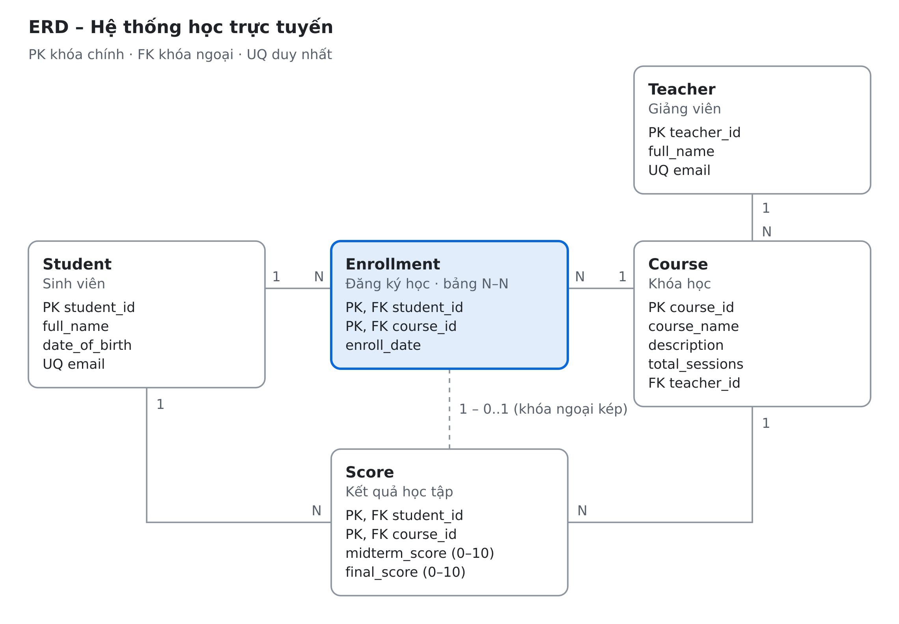

# Hệ thống học trực tuyến – Thiết kế CSDL theo SRS

Hiện thực hóa tài liệu đặc tả (SRS) của hệ thống học trực tuyến thành cơ sở dữ liệu MySQL gồm 5 bảng: `Student`, `Teacher`, `Course`, `Enrollment`, `Score`. Bài làm đi qua đủ quy trình **DDL → INSERT → UPDATE → DELETE → SELECT**.

## 1. Sơ đồ ERD

[](erd-online-learning.png)

[Xem sơ đồ ERD trên draw.io](https://www.draw.io/?title=erd-online-learning.drawio#R7Vlbc5s4FP41evUIsB38aHzpzrTNtk06u33yKCCDJgJ5hZzY%2FfU9AoHBkNgbM7SdOjPJ6Nx0Od93dCHImcW7d5Jsoo8ioBzZOJQsQM4c2TaGX1BsSEgrCmeBnJkUQuWteDejXMfVo5YvWK2iT0kTdU6AYorTPOiJ8K2ZyeIL%2FMVoYSMXo4kD7b%2FQwkKeh9wbEFRkpImVhCAXojv3tVUa0bMycbvP5Cnylkk%2BUqr23Iyk6A7m6UUq5qCwoLkWibpj37XdGheyCdB2wlmYQJvTtY40c6cSenoxB1aZWUCDipgquQcXE2AP84i9cTbAPLMAFpqphtjoIsrCyHRqj3MdSXM5LDs%2B5BsaJuXt6b%2BnxI%2BobACA7DHXq3uARqgbpWOuh35LU%2BkrjzU6ddCvL7iQWb8wY2dn32QuzuhmjMekrszj3zGD2NTJ8H1iaOag6TSpDJ%2F3fWoGB82n95oL%2BSpWsPyGw3rL%2BSohMW2avn6GWBoTxhv8kWKbBDQouCF9Qx3NnOeIKXq3Ib5WPEMR1ol2RCRNIeYTPjVqJbR%2FCuEsCT9kPnOgRqm61%2FZsnDXjfFbm2FlnP9pRSfFIKxbXn4wmB8s%2FhmBWNzQeOeMaj0fjBo%2FtNh5b2L2cyHdqG%2Bh5niRy6dgHke9YEnXJ3zSf%2FP%2Flb0AUXYn16oFJQOJK7y52aRsPz6R3EXgJvReJFJzHZzG86tsHydFsiCZY%2F3Xz7fpRs92bNw5mNLORp8%2Fvh%2Fr2flse9LcXFgjkES9PFUrN0RdbmdJWP5rlcaWL53eoi4BQd%2B231QWejCcBadSF3VFduPiNhdHFvj%2FL8DtdFIVfHwXxPsoKwCHHFXDZ5v8KVY3phd2fpr5kG8VE0jQqoQhfpTRNwZw27cvja9P1gDj3%2FnN%2BIQxxBxcgX8gz6sC49VIG5bNLh%2F%2B3LTf95outMM03v9IBEANuVMarNM8ZgOQe3qT6lTZpuYWxRNfTKxHXAjr3JHFc3OMVi%2BJG9VhHHyFuG%2BjRIKTFxwEBl2sRCsB%2FcdB6B3xxHb1UEammUopnUCy%2BxCQJ%2Fk5odu8IDurvVIp78ZEk%2ByJkyfQSst7AsyJVP1zoATh5oNwj%2FmOYzaENYLpj6l8dPhgZ6ZuZHUAm9xWTFr%2BZgfIs6KW%2FDjRkCorLpy2fGmAhIVXHR3iTGZJyothTfaCLULb%2BXJStCsZ44Ng1mGsgD5ybN%2BNce4lXca6%2FYfrA2v6DK7qGNZw7FaytzrCu3r5%2FLtTOdfNu27zrSI%2B6L%2Bry2tkHyMMryC0gW12B%2FFI194rx6CTGeDCwfhbMueEXuYcFJI3Kl8PbID%2F%2BrtgT7CAe%2FsWY2Sr%2Fo3QWPwA%3D)

| Đối tượng 1 | Đối tượng 2 | Quan hệ (SRS) | Khóa ngoại |
|---|---|---|---|
| Student | Enrollment | 1 – N | `Enrollment.student_id` |
| Course | Enrollment | 1 – N | `Enrollment.course_id` |
| Teacher | Course | 1 – N | `Course.teacher_id` |
| Student | Score | 1 – N | `Score.student_id` |
| Course | Score | 1 – N | `Score.course_id` |
| Enrollment | Score | 1 – 0..1 (bổ sung) | `Score(student_id, course_id)` |

Quan hệ cuối cùng không có trong bảng quan hệ của SRS, nhưng được bổ sung để đảm bảo sinh viên chỉ có điểm ở khóa học mà mình đã đăng ký.

## 2. Đối chiếu quy tắc SRS với ràng buộc

| Quy tắc trong SRS | Ràng buộc trong SQL |
|---|---|
| Mỗi sinh viên, giảng viên, khóa học có mã riêng | `PRIMARY KEY` |
| Email sinh viên không được trùng | `UNIQUE (email)` (áp dụng cả cho giảng viên) |
| Họ tên sinh viên bắt buộc phải có | `NOT NULL` |
| Một giảng viên dạy nhiều khóa học, một khóa học chỉ do một giảng viên phụ trách | `Course.teacher_id NOT NULL` + `FOREIGN KEY → Teacher` |
| Một sinh viên đăng ký nhiều khóa, một khóa có nhiều sinh viên | Bảng trung gian `Enrollment` |
| Không đăng ký trùng một khóa học | `PRIMARY KEY (student_id, course_id)` trong `Enrollment` |
| Điểm từ 0 đến 10 | `CHECK (... BETWEEN 0 AND 10)` |
| Mỗi sinh viên chỉ có một kết quả cho mỗi khóa học | `PRIMARY KEY (student_id, course_id)` trong `Score` |

Lựa chọn kiểu dữ liệu:

- Mã dùng `CHAR(5)` vì luôn dài đúng 5 ký tự (`SV001`, `GV001`, `KH001`).
- Họ tên, email, mô tả dùng `VARCHAR`, chỉ tốn đúng độ dài thực.
- Ngày sinh và ngày đăng ký dùng `DATE`.
- Điểm dùng `DECIMAL(4,2)` để lưu chính xác, cho phép `NULL` khi chưa có điểm.

## 3. Các bước thực hiện

1. **Tạo bảng** theo thứ tự bảng cha trước: `Student` → `Teacher` → `Course` → `Enrollment` → `Score`.
2. **Nhập dữ liệu:** 5 sinh viên, 5 giảng viên, 5 khóa học, 8 lượt đăng ký, 8 kết quả học tập.
3. **Cập nhật:** email sinh viên SV003, mô tả khóa học KH002, điểm cuối kỳ của SV001 ở KH002. Mọi lệnh `UPDATE` có `WHERE` theo khóa chính. Với `Score`, `WHERE` có đủ cả hai cột của khóa chính.
4. **Xóa:** lượt đăng ký không hợp lệ `SV005 – KH005`. Xóa `Score` (bảng con) trước, rồi mới xóa `Enrollment` (bảng cha). Làm ngược lại sẽ bị lỗi khóa ngoại.
5. **Truy vấn:** lấy danh sách sinh viên, giảng viên, khóa học, các lượt đăng ký và kết quả học tập. Mỗi câu truy vấn liệt kê rõ tên cột.

## 4. Kiểm thử ràng buộc

| Lệnh thử | Kết quả |
|---|---|
| Đăng ký lại `SV001 – KH001` | ❌ Trùng khóa chính (đăng ký trùng) |
| Thêm sinh viên có email đã tồn tại | ❌ Vi phạm `UNIQUE` |
| Nhập điểm giữa kỳ = 11 | ❌ Vi phạm `CHECK` |
| Thêm khóa học có 0 buổi | ❌ Vi phạm `CHECK` |
| Thêm khóa học của giảng viên không tồn tại | ❌ Vi phạm khóa ngoại |
| Nhập điểm cho khóa học chưa đăng ký | ❌ Vi phạm khóa ngoại |
| Xóa lượt đăng ký khi vẫn còn điểm | ❌ Vi phạm khóa ngoại |

> Yêu cầu MySQL **8.0.16+**: từ bản này `CHECK` mới được thực thi. `DEFAULT (CURRENT_DATE)` cần 8.0.13+.

## 5. Script SQL hoàn chỉnh

```sql
-- =====================================================
-- HỆ THỐNG HỌC TRỰC TUYẾN (theo tài liệu SRS)
-- DDL (CREATE) -> DML (INSERT, UPDATE, DELETE) -> SELECT
-- MySQL 8.0.16+ (CHECK cần 8.0.16+, DEFAULT (CURRENT_DATE) cần 8.0.13+)
-- =====================================================

-- =====================================================
-- PHẦN I: THIẾT KẾ & TẠO BẢNG (DDL)
-- =====================================================
CREATE DATABASE IF NOT EXISTS online_learning
    DEFAULT CHARACTER SET utf8mb4;
USE online_learning;

-- Xóa bảng cũ (nếu có): bảng con trước, bảng cha sau
DROP TABLE IF EXISTS Score;
DROP TABLE IF EXISTS Enrollment;
DROP TABLE IF EXISTS Course;
DROP TABLE IF EXISTS Teacher;
DROP TABLE IF EXISTS Student;

-- 1. Sinh viên
CREATE TABLE Student (
    student_id    CHAR(5)      NOT NULL,
    full_name     VARCHAR(100) NOT NULL,
    date_of_birth DATE         NOT NULL,
    email         VARCHAR(100) NOT NULL,
    CONSTRAINT pk_student       PRIMARY KEY (student_id),
    CONSTRAINT uq_student_email UNIQUE (email),
    CONSTRAINT chk_student_email CHECK (email LIKE '%_@_%._%')
);

-- 2. Giảng viên (Teacher)
CREATE TABLE Teacher (
    teacher_id CHAR(5)      NOT NULL,
    full_name  VARCHAR(100) NOT NULL,
    email      VARCHAR(100) NOT NULL,
    CONSTRAINT pk_teacher       PRIMARY KEY (teacher_id),
    CONSTRAINT uq_teacher_email UNIQUE (email),
    CONSTRAINT chk_teacher_email CHECK (email LIKE '%_@_%._%')
);

-- 3. Khóa học (1 giảng viên dạy nhiều khóa, 1 khóa chỉ do 1 giảng viên phụ trách)
CREATE TABLE Course (
    course_id      CHAR(5)      NOT NULL,
    course_name    VARCHAR(100) NOT NULL,
    description    VARCHAR(255),
    total_sessions INT          NOT NULL,
    teacher_id     CHAR(5)      NOT NULL,
    CONSTRAINT pk_course          PRIMARY KEY (course_id),
    CONSTRAINT chk_course_sessions CHECK (total_sessions > 0),
    CONSTRAINT fk_course_teacher
        FOREIGN KEY (teacher_id) REFERENCES Teacher (teacher_id)
);

-- 4. Đăng ký học (N - N giữa Student và Course)
CREATE TABLE Enrollment (
    student_id  CHAR(5) NOT NULL,
    course_id   CHAR(5) NOT NULL,
    enroll_date DATE    NOT NULL DEFAULT (CURRENT_DATE),
    CONSTRAINT pk_enrollment PRIMARY KEY (student_id, course_id),   -- không đăng ký trùng
    CONSTRAINT fk_enrollment_student
        FOREIGN KEY (student_id) REFERENCES Student (student_id),
    CONSTRAINT fk_enrollment_course
        FOREIGN KEY (course_id)  REFERENCES Course (course_id)
);

-- 5. Kết quả học tập (Score)
CREATE TABLE Score (
    student_id    CHAR(5)      NOT NULL,
    course_id     CHAR(5)      NOT NULL,
    midterm_score DECIMAL(4, 2),
    final_score   DECIMAL(4, 2),
    CONSTRAINT pk_score PRIMARY KEY (student_id, course_id),       -- 1 kết quả / sinh viên / khóa học
    CONSTRAINT chk_score_midterm CHECK (midterm_score BETWEEN 0 AND 10),
    CONSTRAINT chk_score_final   CHECK (final_score   BETWEEN 0 AND 10),
    CONSTRAINT fk_score_student
        FOREIGN KEY (student_id) REFERENCES Student (student_id),          -- Student 1 - N Score
    CONSTRAINT fk_score_course
        FOREIGN KEY (course_id)  REFERENCES Course (course_id),            -- Course 1 - N Score
    CONSTRAINT fk_score_enrollment
        FOREIGN KEY (student_id, course_id) REFERENCES Enrollment (student_id, course_id)  -- chỉ chấm điểm khóa đã đăng ký
);

-- =====================================================
-- PHẦN II: NHẬP DỮ LIỆU BAN ĐẦU (bảng cha trước, bảng con sau)
-- =====================================================
INSERT INTO Student (student_id, full_name, date_of_birth, email) VALUES
    ('SV001', 'Nguyễn Văn An',   '2005-03-12', 'an.nguyen@student.edu.vn'),
    ('SV002', 'Trần Thị Bình',   '2005-07-25', 'binh.tran@student.edu.vn'),
    ('SV003', 'Lê Hoàng Cường',  '2004-11-02', 'cuong.le@student.edu.vn'),
    ('SV004', 'Phạm Thu Dung',   '2005-01-18', 'dung.pham@student.edu.vn'),
    ('SV005', 'Hoàng Minh Đức',  '2004-09-30', 'duc.hoang@student.edu.vn');

INSERT INTO Teacher (teacher_id, full_name, email) VALUES
    ('GV001', 'TS. Nguyễn Quang Huy', 'huy.nq@university.edu.vn'),
    ('GV002', 'ThS. Trần Mai Lan',    'lan.tm@university.edu.vn'),
    ('GV003', 'TS. Lê Văn Khoa',      'khoa.lv@university.edu.vn'),
    ('GV004', 'ThS. Phạm Ngọc Anh',   'anh.pn@university.edu.vn'),
    ('GV005', 'PGS. Đỗ Thanh Tùng',   'tung.dt@university.edu.vn');

INSERT INTO Course (course_id, course_name, description, total_sessions, teacher_id) VALUES
    ('KH001', 'Cơ sở dữ liệu',          'Thiết kế CSDL quan hệ và ngôn ngữ SQL',  15, 'GV001'),
    ('KH002', 'Lập trình Python',       'Python cơ bản cho người mới bắt đầu',    20, 'GV002'),
    ('KH003', 'Cấu trúc dữ liệu',       'Mảng, danh sách liên kết, cây, đồ thị',   15, 'GV003'),
    ('KH004', 'Mạng máy tính',          'Mô hình OSI, TCP/IP và định tuyến',      12, 'GV004'),
    ('KH005', 'Trí tuệ nhân tạo',       'Tìm kiếm, học máy và mạng nơ-ron',       18, 'GV001');

INSERT INTO Enrollment (student_id, course_id, enroll_date) VALUES
    ('SV001', 'KH001', '2026-09-01'),
    ('SV001', 'KH002', '2026-09-01'),
    ('SV002', 'KH001', '2026-09-02'),
    ('SV002', 'KH003', '2026-09-02'),
    ('SV003', 'KH004', '2026-09-03'),
    ('SV004', 'KH005', '2026-09-03'),
    ('SV005', 'KH002', '2026-09-04'),
    ('SV005', 'KH005', '2026-09-05');   -- lượt đăng ký không hợp lệ (sẽ xóa ở Phần IV)

INSERT INTO Score (student_id, course_id, midterm_score, final_score) VALUES
    ('SV001', 'KH001', 8.0,  8.5),
    ('SV001', 'KH002', 7.5,  NULL),     -- chưa thi cuối kỳ
    ('SV002', 'KH001', 9.0,  9.5),
    ('SV002', 'KH003', 6.5,  7.0),
    ('SV003', 'KH004', 5.0,  6.0),
    ('SV004', 'KH005', 8.5,  9.0),
    ('SV005', 'KH002', 7.0,  7.5),
    ('SV005', 'KH005', 4.0,  NULL);

-- =====================================================
-- PHẦN III: CẬP NHẬT DỮ LIỆU (luôn có WHERE theo khóa chính)
-- =====================================================
-- 1. Cập nhật email cho sinh viên SV003
UPDATE Student
SET email = 'cuong.lehoang@student.edu.vn'
WHERE student_id = 'SV003';

-- 2. Cập nhật mô tả cho khóa học KH002
UPDATE Course
SET description = 'Python từ cơ bản đến xử lý dữ liệu với pandas'
WHERE course_id = 'KH002';

-- 3. Cập nhật điểm cuối kỳ cho sinh viên SV001 ở khóa KH002
UPDATE Score
SET final_score = 8.0
WHERE student_id = 'SV001' AND course_id = 'KH002';

-- =====================================================
-- PHẦN IV: XÓA DỮ LIỆU
-- Lượt đăng ký SV005 - KH005 không hợp lệ
-- Phải xóa kết quả (bảng con) TRƯỚC, rồi mới xóa lượt đăng ký (bảng cha)
-- =====================================================
DELETE FROM Score
WHERE student_id = 'SV005' AND course_id = 'KH005';

DELETE FROM Enrollment
WHERE student_id = 'SV005' AND course_id = 'KH005';

-- =====================================================
-- PHẦN V: TRUY VẤN DỮ LIỆU
-- =====================================================
-- 1. Danh sách sinh viên
SELECT student_id, full_name, date_of_birth, email
FROM Student;

-- 2. Danh sách giảng viên
SELECT teacher_id, full_name, email
FROM Teacher;

-- 3. Danh sách khóa học
SELECT course_id, course_name, description, total_sessions, teacher_id
FROM Course;

-- 4. Các lượt đăng ký khóa học
SELECT student_id, course_id, enroll_date
FROM Enrollment;

-- 5. Kết quả học tập
SELECT student_id, course_id, midterm_score, final_score
FROM Score;
```
